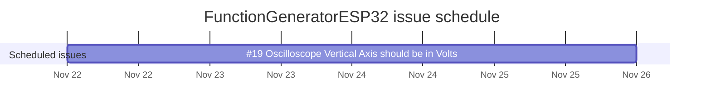

# GitHub Issues Gantt

Initial preview uses Issue #19's native issue Fields dates confirmed in the GitHub issue sidebar on 2026-11-22. Future updates are generated automatically from issue field values.

**Issue #19:** Start date 2026-11-22; Target date 2026-11-25 (inclusive). These dates are from its issue-level Fields sidebar.

## Unscheduled issues

| Issue | Status |
| --- | --- |
| [#1 — Simulate Biological outputs](https://github.com/nk25719/FunctionGeneratorESP32/issues/1) | Not scheduled |
| [#4 — Function Generator, Increase Maximum Frequency. Up to 20KHz would cover the Audio range for example](https://github.com/nk25719/FunctionGeneratorESP32/issues/4) | Not scheduled |
| [#5 — feature request, make the grid lines darker](https://github.com/nk25719/FunctionGeneratorESP32/issues/5) | Not scheduled |
| [#6 — Function Generator, Connect to Audio Amplifier and Speakers and to OScope High Inputs.](https://github.com/nk25719/FunctionGeneratorESP32/issues/6) | Not scheduled |
| [#7 — Make FG and OScope Controllable By SCPI](https://github.com/nk25719/FunctionGeneratorESP32/issues/7) | Not scheduled |
| [#8 — Oscilloscope Feature Request, Add Trigger System](https://github.com/nk25719/FunctionGeneratorESP32/issues/8) | Not scheduled |
| [#9 — Function Generator, Add Rectangle Wave, Set a frequency and a Duty Cycle](https://github.com/nk25719/FunctionGeneratorESP32/issues/9) | Not scheduled |
| [#10 — Function Generator, Add Arbitrary Wave Form Generation](https://github.com/nk25719/FunctionGeneratorESP32/issues/10) | Not scheduled |
| [#11 — Firmware, Runtime Errors?,  "getString(): nvs_get_str len fail: ch0_wave NOT_FOUND ..."](https://github.com/nk25719/FunctionGeneratorESP32/issues/11) | Not scheduled |
| [#12 — Firmware, SoftAP Not Unique, User Cannot Identify individual Function Generators WiFi.](https://github.com/nk25719/FunctionGeneratorESP32/issues/12) | Not scheduled |
| [#14 — Add device-information splash screen](https://github.com/nk25719/FunctionGeneratorESP32/issues/14) | Not scheduled |
| [#17 — Oscilliscope Display, Cannot Set for Longer Window](https://github.com/nk25719/FunctionGeneratorESP32/issues/17) | Not scheduled |
| [#18 — Heart Beat on Buildin_LED Missing](https://github.com/nk25719/FunctionGeneratorESP32/issues/18) | Not scheduled |
| [#20 — Implement, Best Practices for Pinout Management and more](https://github.com/nk25719/FunctionGeneratorESP32/issues/20) | Not scheduled |
| [#23 — [FW]: Function Generator, Output Stopped Over Night,](https://github.com/nk25719/FunctionGeneratorESP32/issues/23) | Not scheduled |
| [#24 — [FW]: Web Page, Function Generator, Frequencey Input Unstable](https://github.com/nk25719/FunctionGeneratorESP32/issues/24) | Not scheduled |
| [#25 — [FW]: Make firmware Version Visible,  Tester and User](https://github.com/nk25719/FunctionGeneratorESP32/issues/25) | Not scheduled |
| [#26 — [FW]: Oscilloscope Horizontal Axis, Set Time / Division](https://github.com/nk25719/FunctionGeneratorESP32/issues/26) | Not scheduled |
| [#27 — [FW]: Firmware version not updating](https://github.com/nk25719/FunctionGeneratorESP32/issues/27) | Not scheduled |
| [#28 — [Task]: Issue templates are miss leading](https://github.com/nk25719/FunctionGeneratorESP32/issues/28) | Not scheduled |
| [#29 — [Enhancement]: Embedded Web Page Has Button For Bug / Enhancement Reporting](https://github.com/nk25719/FunctionGeneratorESP32/issues/29) | Not scheduled |
| [#30 — [Enhancement]: Add to the repository a down load page for the most recent released .bin file and any release candates](https://github.com/nk25719/FunctionGeneratorESP32/issues/30) | Not scheduled |
| [#31 — [FW]: PWM Screen, No trigger on SINE or Square wave from FG.  Nonsensical Duty Cycle](https://github.com/nk25719/FunctionGeneratorESP32/issues/31) | Not scheduled |
| [#32 — [FW]: Embedded Web Pages Refer to Waveform Generator but should be Function Generator](https://github.com/nk25719/FunctionGeneratorESP32/issues/32) | Not scheduled |
| [#33 — [Task]: Update Main README.md to reflect project status as of 20261122](https://github.com/nk25719/FunctionGeneratorESP32/issues/33) | Not scheduled |

## Scheduling an issue

Set **Start date** and **Target date** in the issue sidebar **Fields** section.

After this feature is merged, GitHub Actions refreshes this document on issue changes and daily.
